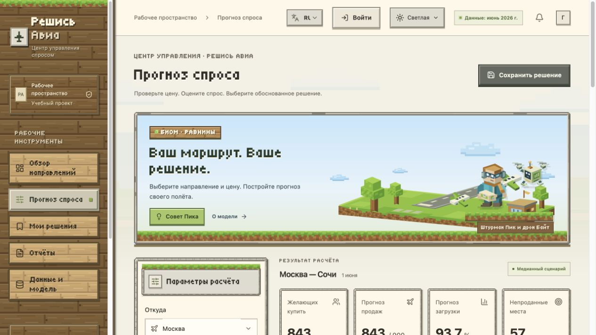
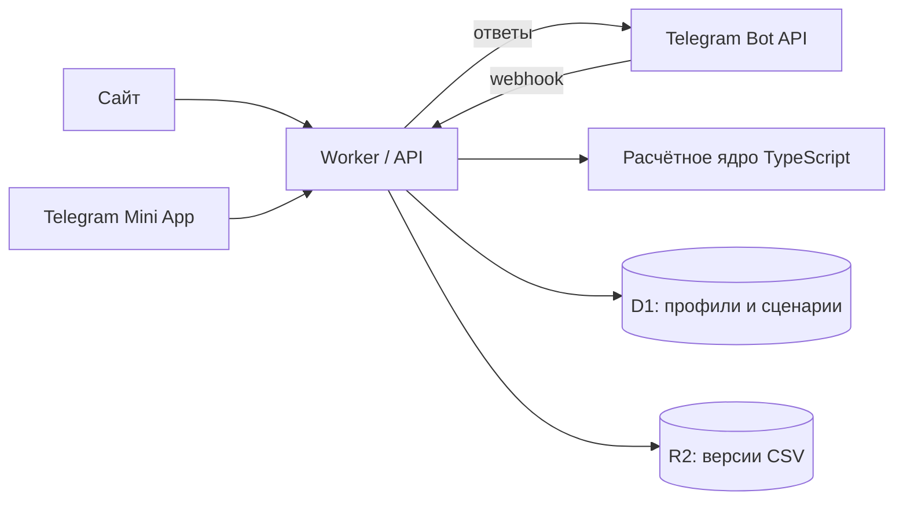

# Решись Авиа

**[Открыть сайт](https://reshis-avia-cu-20261104.robust-boot-4212.chatgpt.site) · [Telegram-бот @CU_AviGo_app](https://t.me/CU_AviGo_app)**

[](https://github.com/zoli801/reshis-avia/actions/workflows/ci.yml)

Прогноз спроса на авиабилеты, сравнение цен и сохранение обоснованных решений.

**Автор: Чехлов Дмитрий Олегович · Блок 3 — «Разработка»**

[Документация](docs/DEVELOPMENT.md) · [Сдача кейса](docs/SUBMISSION.md)



## Возможности

- **Прогноз:** маршрут, дата и цена → спрос, продажи, загрузка, свободные места, выручка и маржинальный доход.
- **Три графика:** квантили спроса, доходность от цены и динамика по датам. Есть совместный просмотр и выбор точки на графике.
- **Решения:** сохранение сценариев, заметки, согласование, CSV и печатный отчёт с возможностью сохранения в PDF.
- **Аккаунты:** гостевой доступ, регистрация по логину и паролю, вход через ChatGPT или подтверждение в Telegram.
- **Telegram:** самостоятельный бот и Mini App; объединение с профилем сайта — только по выбору пользователя.
- **Интерфейс:** русский и английский языки, светлая и тёмная темы, воксельный биом «Равнины», поддержка уменьшения анимаций.

## Архитектура



**Стек:** TypeScript, React, Vinext, Cloudflare Workers, D1, R2 и Telegram Bot API. Веб-интерфейс и бот используют одно расчётное ядро.

## Структура проекта

| Путь | Назначение |
| --- | --- |
| `app/avia/` | Сайт и Mini App: формы, графики, аккаунты, языки и темы. |
| `app/api/`, `app/mcp/` | HTTP API и административные инструменты обработки очереди. |
| `lib/aviation/` | Формулы, аналитика, чтение CSV и формирование отчётов. |
| `lib/server/` | Авторизация, сценарии, роли, версии данных и Telegram-бот. |
| `db/`, `drizzle/` | Схема базы и SQL-миграции. |
| `public/materials/` | Собственный CSV прогноза и справочник направлений. |
| `public/voxel/`, `public/fonts/` | Оригинальная графика и шрифт с лицензиями. |
| `scripts/`, `tests/` | Локальный запуск, сборка и автоматические проверки. |
| `docs/` | Техническая документация, материалы оформления и инструкция сдачи. |

## Локальный запуск

Нужны **Node.js 26.5.0** и npm.

```sh
git clone https://github.com/zoli801/reshis-avia.git
cd reshis-avia
npm run install:ci
npm run setup:local
npm run build
npm run db:migrate
npm run dev
```

Откройте адрес сервера — обычно [http://localhost:5173](http://localhost:5173). `setup:local` создаёт случайный локальный секрет паролей и сохраняет существующие настройки. Миграции применяются к локальной D1.

**Токен бота для интерфейса и тестов не нужен.** Настоящие Telegram и ChatGPT подключаются отдельно; особенности локальной эмуляции и развёртывания описаны в [DEVELOPMENT.md](docs/DEVELOPMENT.md).

## Данные и расчёты

Используется собственный файл [Chekhlov_Dmitrii_Olegovich_my_forecast.csv](public/materials/Chekhlov_Dmitrii_Olegovich_my_forecast.csv): **155 записей, пять маршрутов из Москвы, 1 июня — 1 июля 2026 года**.

ML-модель заранее формирует CSV. Сервер пересчитывает каждый квантиль при одной введённой цене по формуле задания:

```text
спрос = base_demand − price_sensitivity × (цена − base_price)
продажи = min(seats, max(0, спрос))
```

Основные показатели используют медиану P50. На графике отмечены девять квантилей и вместимость. Данные кейса фиксированы: фактические бронирования и рыночные цены не подключены.

**Контрольный пример:** Москва → Сочи, 1 июня, 9 000 ₽ — спрос и продажи **843**, вместимость **900**.

## Проверки и безопасность

```sh
npm run typecheck
npm test
npm run build
```

Проверки охватывают расчёты, CSV, права, изоляцию профилей, смену паролей, документы, языки и Telegram. Они используют синтетические данные и не требуют production-секретов.

- Значения секретов хранятся локально или в серверных настройках Sites; локальные файлы и состояние эмулятора исключены из Git.
- Браузеру не передаётся токен бота; сервер проверяет подписи Telegram и права на каждую операцию.
- Пароли защищены солью, PBKDF2 и серверным секретом; в базе хранятся хеши токенов сессий.
- Профили сайта и Telegram независимы по умолчанию. Владелец получает права по подтверждённой идентичности.

Проверки секретов перед commit/push и в GitHub Actions описаны в [SECURITY.md](SECURITY.md).

